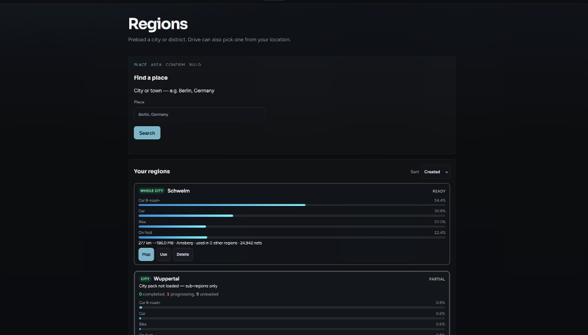
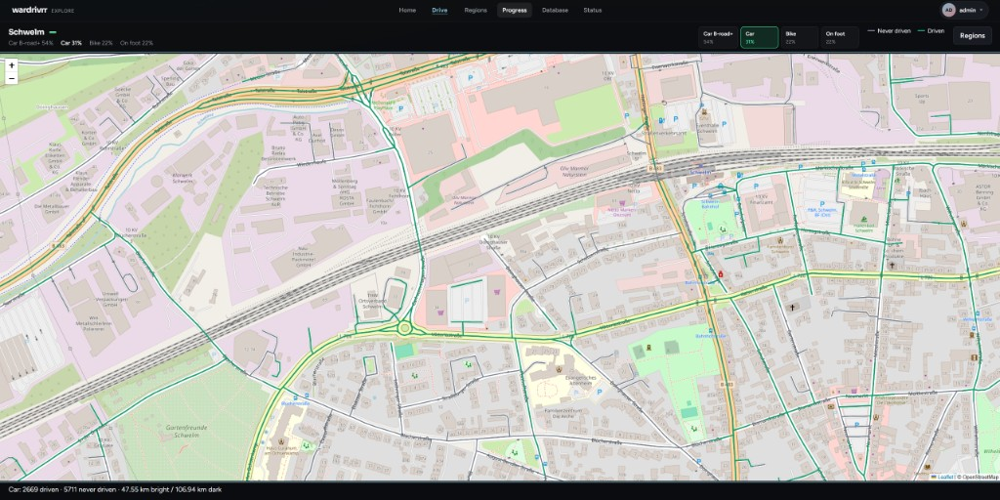
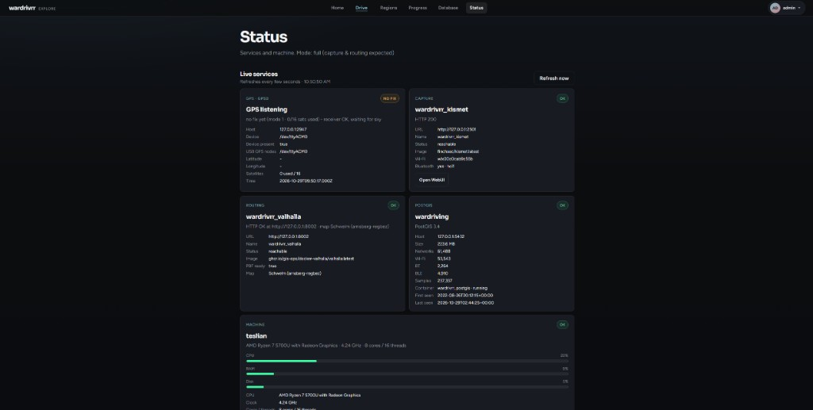
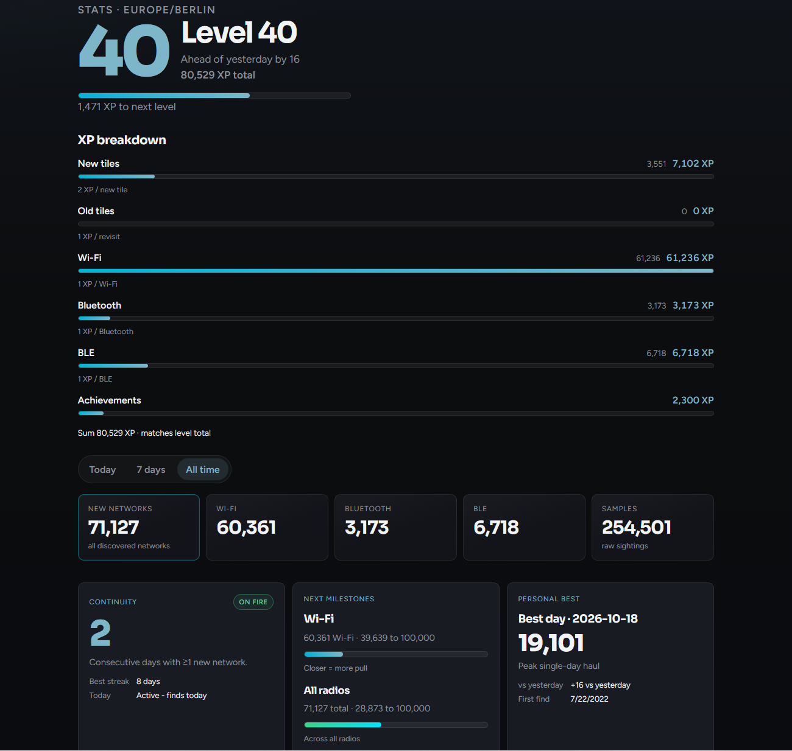

# wardrivrr


**Discover your digital surroundings.** · **Version 1.0.0**

Local-first wardriving on OpenStreetMap: GPS unlocks road segments as you drive, the map shows what’s still unexplored, and offline routing points you toward streets you haven’t covered yet. Kismet fills in Wi‑Fi / Bluetooth sightings. Everything runs on your machine — PostGIS, UI, and routing — no cloud account.

---

## Screenshots

| Drive | Regions | Progress |
| --- | --- | --- |
|  |  |  |
| Turn-by-turn into unexplored streets | Pick a place, download a map pack | Fog of war and XP |

| Status | Stats |
| --- | --- |
|  |  |
| GPS, Kismet, routing, disk at a glance | Levels, achievements, radio totals |

Drop PNGs into `docs/screenshots/` (see that folder’s README). Until then the slots above are placeholders.

---

## Install

Product version (**1.0.0**) is shown in this README header, on the home page, and via `/api/health`. Image tag: **`:latest`**.

### Docker Compose

Optional: set a host data directory. No `.env` file. Wi‑Fi / Bluetooth / Kismet password are configured in the Web UI after login.

**Host prerequisites**

- Linux with Docker Compose v2 (API + Kismet use host networking for radio).
- **No existing Kismet** on the host (no `kismet.service`, nothing on `:2501` / `:3501`). Compose runs Kismet in Docker; a host install will conflict and crash-loop the container:
  ```bash
  sudo systemctl stop kismet 2>/dev/null; sudo systemctl disable kismet 2>/dev/null
  ```
- **gpsd** must already be installed and talking to your GPS receiver on `127.0.0.1:2947` (wardrivrr does not install or configure gpsd).

```bash
git clone https://github.com/JAKAMI99/wardrivrr.git
cd wardrivrr

# Persist data somewhere durable (absolute path recommended on the host mini):
export DATA_ROOT=/var/lib/wardrivrr
# Or omit DATA_ROOT to use ./data next to the compose file.
```

**Option 1 — pull published image (default)**

Compose uses `ghcr.io/jakami99/wardrivrr:latest`:

```bash
docker compose up -d
```

Override the tag if needed:

```bash
WARDRIVRR_IMAGE=ghcr.io/jakami99/wardrivrr:latest docker compose up -d
```

**Option 2 — build local Docker image**

Build the API from this tree (useful when GHCR is private, offline, or you changed the backend):

```bash
docker compose build api
docker compose up -d
```

Force recreate after a rebuild:

```bash
docker compose up -d --build --force-recreate api
```

Then open `http://<host-ip>:1337/`:

1. **Setup** — create the admin password (no default login)
2. **Login** — as `admin`
3. **Machine setup** — dropdowns for Wi‑Fi, Bluetooth, optional GPS serial hint, Kismet password → **Apply & restart Kismet**
4. **Regions** → **Drive**

Health check:

```bash
curl -fsS http://127.0.0.1:1337/api/health
# → {"ok":true,"version":"1.0.0",...}
```

### Manual install (bare metal)

Host API + PostGIS for development:

```bash
python -m venv venv
venv/bin/pip install -r backend/requirements.txt   # Windows: .\venv\Scripts\pip.exe …
docker compose up -d postgis
./debug.sh                                         # or .\debug.bat
```

Open `http://127.0.0.1:1337/setup`. Full Drive (Kismet / Valhalla / host GPS) is meant for the Compose path above.

---

## Data import

**WiGLE account (one click):** In the Web UI go to **Settings → Data → WiGLE account**. Paste the **Encoded for Use** API key from [wigle.net/account](https://wigle.net/account), click **Save API key**, then **Import from WiGLE**. wardrivrr lists your WiGLE uploads, downloads each as WiGLE CSV, and ingests them like a manual file upload. Re-import skips CSV files already saved under your incoming folder.

**Manual files:** The same **Settings → Data** panel accepts Kismet `.kismet` and WiGLE CSV uploads.

**Backups:** Full user backups include `user_settings.json`, which may contain your saved WiGLE API credentials — treat export zips like secrets.

---

## First boot

On a new install there is **no** default password. The UI redirects to `/setup` until you create the admin account (password, minimum 8 characters). Username is `admin`. After login, admins are sent to **Machine setup** until Wi‑Fi / Kismet are configured.

---

## Reset admin password

**Docker (host stack):**

```bash
./scripts/reset-admin-password.sh 'YourNewPassword'
# Windows:
.\scripts\reset-admin-password.ps1 'YourNewPassword'
```

One-liner without the wrapper:

```bash
docker compose exec -T api \
  python /app/scripts/reset_admin_password.py 'YourNewPassword'
```

**Local debug:**

```bash
WARDRIVRR_RESET_LOCAL=1 ./scripts/reset-admin-password.sh 'YourNewPassword'
# or:
python scripts/reset_admin_password.py 'YourNewPassword'
```

Omit the password argument to be prompted interactively.

---

## Config notes

| Knob | Notes |
| --- | --- |
| `DATA_ROOT` | Host path for persistent data (map packs, Kismet conf/logs, JWT file, Valhalla). Default `./data`. Prefer an absolute path on the mini. |
| `WARDRIVRR_IMAGE` | Optional image override; default `ghcr.io/jakami99/wardrivrr:latest`. |
| Machine setup (Web UI) | Wi‑Fi / Bluetooth / Kismet password — stored under `$DATA_ROOT/machine.json` + `kismet/kismet_site.conf`; restarts the Compose `kismet` container. |
| Host Kismet | **Must not** be installed; use the Compose service only. |
| gpsd | **Required** on the host (`127.0.0.1:2947`) before live GPS / Drive. |
| JWT | Auto-written to `$DATA_ROOT/.jwt_secret` if unset. |

| Service | Port |
| --- | --- |
| API + UI | `1337` |
| Valhalla | `8002` |
| PostGIS | `5432` (bound `127.0.0.1`) |
| Kismet | `2501` |
| gpsd (host) | `2947` |

**Maps & routing:** create a **Region** in the UI → regional pack cached in `$DATA_ROOT/pbf/` (~7 days) → clip + Valhalla tiles → **Drive**. Live routing uses Valhalla tiles / `active.osm.pbf`, not the regional pack.

Ship checklist: [docs/SHIP_CHECKLIST.md](docs/SHIP_CHECKLIST.md).

---

## Layout

| Path | Role |
| --- | --- |
| `docker-compose.yml` | Single fire-and-forget stack |
| `debug.sh` / `debug.bat` | Host API via `run_dev.py` (dev) |
| `backend/` | FastAPI + `Dockerfile` |
| `frontend/` | Web UI (incl. `/machine-setup`) |
| `deploy/kismet/` | Default Kismet site conf template |
| `scripts/` | Helpers (wipe, ingest, password reset) |
| `$DATA_ROOT` | Map packs, Valhalla, Kismet logs/conf, `.jwt_secret` |
| `VERSION` | Product version (also home page / `/api/health`) |

---

## Credits

Upstream map, place, and MAC/OUI data: [CREDITS.md](CREDITS.md).

## License

[GPL-2.0](LICENSE)
